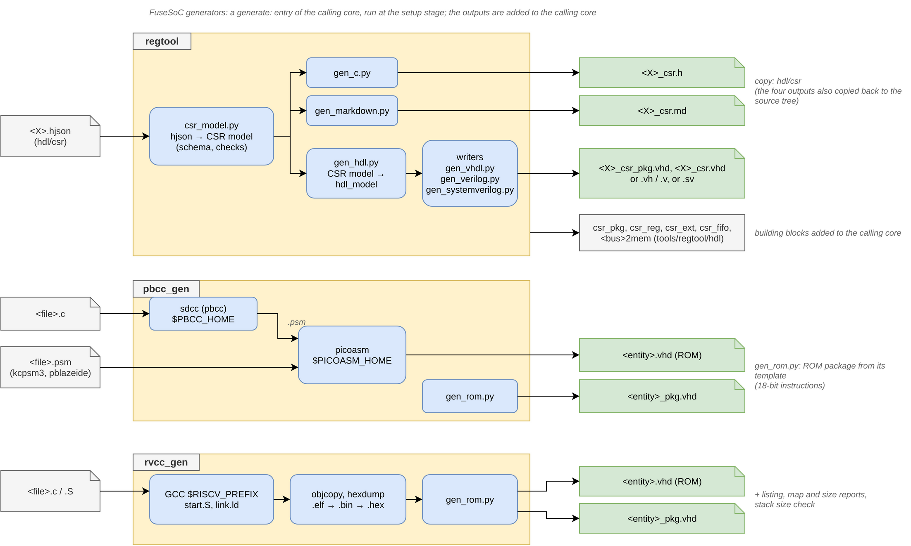
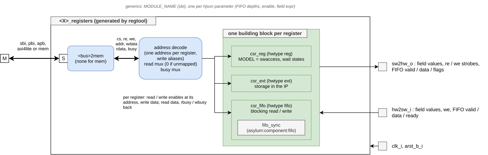

<!--
  README MODEL (common to every Asylum IP, keep the same headings)
  ----------------------------------------------------------------
  Regenerate from the sources, never from the previous README text alone:
    generators.core, ghdl_synth.core, yosys_synth.core (VLNV, generators,
    targets, depends), mk/targets.txt, generators/, tools/regtool/
    (regtool, hdl/, sim/, tests/), tools/ghdl, tools/yosys, syn/, scripts/.
  Sections, in this order:
    badges / title + one-line pitch / Overview / Features / Block Diagram /
    Getting Started / Hardware Interfaces / Configuration / Resources /
    Theory of Operation / Registers / Programmer's Guide /
    Design Verification / Dependencies and Related IPs / License
  Rules:
    - English, short and factual: every statement backed by the sources.
    - No VLNV line: the version badge shows it.
    - Badges: first line version, license; second line CI, lint, sim, syn.
    - Block diagram: pages Overview (generator flows) and CSR (generated
      bank) of doc/generators.drawio, exported to doc/generators-<page>.png
      (make -C doc).
    - This repository is the toolchain of the Asylum IPs: it is the reference
      documentation of regtool (hjson format, access models, outputs) and of
      the lint / synthesis scripts; never shorten it. pbcc_gen and rvcc_gen
      are CPU toolchains: they name their CPU.
    - Registers: link to a generated <X>_csr.md, never copy register tables.
    - Tables: Configuration = Name|Type|Default|Description,
      Hardware Interfaces = Name|Direction|Type|Description, grouped by interface.
    - A section with nothing to say is one line, never removed.
-->
[](https://github.com/deuskane/asylum-utils-generators/tags)
[](LICENSE)

[](https://github.com/deuskane/asylum-utils-generators/actions/workflows/ci.yml)
[](https://github.com/deuskane/asylum-utils-generators/actions/workflows/ci.yml)
[](https://github.com/deuskane/asylum-utils-generators/actions/workflows/ci.yml)
[](https://github.com/deuskane/asylum-utils-generators/actions/workflows/ci.yml)

# Asylum generators

**The FuseSoC generators of Asylum: regtool (CSR banks from an hjson description), pbcc_gen and rvcc_gen (firmware to ROM), with the CSR building blocks and the lint / synthesis scripts used by every Asylum IP.**

Part of the [Asylum project](https://github.com/deuskane/asylum-project), a collection of small IP cores, written to be read and learned from.

## Table of Contents

1. [Overview](#overview)
2. [Features](#features)
3. [Block Diagram](#block-diagram)
4. [Getting Started](#getting-started)
5. [Hardware Interfaces](#hardware-interfaces)
6. [Configuration](#configuration)
7. [Resources](#resources)
8. [Theory of Operation](#theory-of-operation)
9. [Registers](#registers)
10. [Programmer's Guide](#programmers-guide)
11. [Design Verification](#design-verification)
12. [Dependencies and Related IPs](#dependencies-and-related-ips)
13. [License](#license)

## Overview

This repository provides the code generators used by the other Asylum cores through the FuseSoC `generate:` mechanism. It declares three generators in [generators.core](generators.core):

- **`regtool`**: reads a register description (`hdl/csr/<X>.hjson`) and produces a CSR bank (`<X>_registers`, VHDL, Verilog or SystemVerilog) with its package / header, a C header and a Markdown documentation. The CSR logic has a memory interface; a bus (`sbi`, `pbi`, `apb`, `axi4lite`) is connected through a bridge `<bus>2mem`. Used by every IP with registers (`gen_csr` in their core).
- **`pbcc_gen`**: compiles a C file with the PicoBlaze port of SDCC (pbcc) or takes a KCPSM3 / PBlazeIDE assembler file, assembles it with picoasm and produces a ROM entity plus its component package (OpenBlaze8 / PicoBlaze-3 processors).
- **`rvcc_gen`**: compiles C / assembler with a RISC-V GCC toolchain (`rv32i`) and produces a ROM entity plus its component package (WardRV processor).

Every generator renders a `Makefile` from a Jinja2 template, runs `make` in the FuseSoC generator work directory under an exclusive file lock, and registers the produced files in the calling core. The core itself has no HDL fileset in its `default` target (the `regtool_hdl` fileset is only used by the lint targets): `default` only pulls `asylum:component:fifo`, required by the `csr_fifo` building block that regtool adds to the calling core, and `asylum:utils:ghdl_synth` (scripts of the `lint_ghdl_synth_*` targets). The `sim_*` targets verify regtool (see [Design Verification](#design-verification)).

### Content of the Repository

| Unit | Kind | File | Description |
|------|------|------|-------------|
| `regtool` | FuseSoC generator | [generators/regtool/regtool.py](generators/regtool/regtool.py) + [templates/Makefile.j2](generators/regtool/templates/Makefile.j2) | CSR generator wrapper |
| `pbcc_gen` | FuseSoC generator | [generators/pbcc/pbcc.py](generators/pbcc/pbcc.py) + [templates/Makefile.j2](generators/pbcc/templates/Makefile.j2) | PicoBlaze ROM generator |
| `rvcc_gen` | FuseSoC generator | [generators/rvcc/rvcc.py](generators/rvcc/rvcc.py) + [templates/](generators/rvcc/templates/) | RISC-V ROM generator (`Makefile.j2`, `start.S`, `link.ld`) |
| regtool | Python tool | [tools/regtool/regtool.py](tools/regtool/regtool.py) (command line), [csr_model.py](tools/regtool/csr_model.py), [addrmap.py](tools/regtool/addrmap.py), [regtool_schema.hjson](tools/regtool/regtool_schema.hjson) | hjson parser / checker (CSR model) |
| regtool HDL generator | Python tool | [gen_hdl.py](tools/regtool/gen_hdl.py) | CSR model -> package / module of the CSR (`hdl_model`), calls the VHDL, Verilog or SystemVerilog writer |
| HDL model and writers | Python tool | [hdl_model.py](tools/regtool/hdl_model.py), [gen_vhdl.py](tools/regtool/gen_vhdl.py), [gen_verilog.py](tools/regtool/gen_verilog.py), [gen_systemverilog.py](tools/regtool/gen_systemverilog.py) | Generic description of a package / module (types, records, expressions, signals, assignments, instances, generate) and its VHDL / Verilog / SystemVerilog writers (the SystemVerilog writer derives the Verilog one), independent of the CSR |
| regtool documentation generators | Python tool | [gen_c.py](tools/regtool/gen_c.py), [gen_markdown.py](tools/regtool/gen_markdown.py) | C header, Markdown |
| `csr_pkg`, `csr_reg`, `csr_ext`, `csr_fifo` | VHDL, Verilog | [tools/regtool/hdl/](tools/regtool/hdl/) | CSR building blocks instantiated by generated banks |
| `sbi2mem`, `pbi2mem`, `apb2mem`, `axi4lite2mem` | VHDL (+ Verilog for apb, axi4lite) | [tools/regtool/hdl/](tools/regtool/hdl/) | Bridges from a bus to the memory interface of the CSR |
| regtool tests | pytest, VHDL, Verilog | [tools/regtool/tests/](tools/regtool/tests/), [tools/regtool/sim/](tools/regtool/sim/) | Unit tests and testbenches (see [Design Verification](#design-verification)) |
| gen_rom | Python tool | [generators/gen_rom/gen_rom.py](generators/gen_rom/gen_rom.py) + [ROM/](generators/gen_rom/ROM/) | Fills ROM / ROM package templates from a hex file |
| picoasm | C++ tool | [tools/picoasm/](tools/picoasm/) | PicoBlaze assembler with ROM templates |
| ghdl_synth | Shell + Makefile | [tools/ghdl/ghdl_synth.sh](tools/ghdl/ghdl_synth.sh), [ghdl_synth.mk](tools/ghdl/ghdl_synth.mk) | `pre_run` hook of the `lint_ghdl_synth_*` targets of the Asylum cores (core `asylum:utils:ghdl_synth`, [ghdl_synth.core](ghdl_synth.core), without dependency, also a dependency of generators; copied in the build directory with the GHDL tool): `ghdl --synth` with the options of the target |
| yosys_synth | Shell + Makefile + Python | [tools/yosys/yosys_synth.sh](tools/yosys/yosys_synth.sh), [yosys_synth.mk](tools/yosys/yosys_synth.mk), [yosys_synth.py](tools/yosys/yosys_synth.py) | `pre_run` hook of the `syn_*` targets of the Asylum cores (core `asylum:utils:yosys_synth`, [yosys_synth.core](yosys_synth.core), without dependency; copied in the build directory with the GHDL tool): Yosys synthesis, size on Artix-7 and area on sky130 (see [Resources](#resources)) |
| sdcc | C tool sources | `tools/pbccv2-src-20110901/`, `tools/pbccv2-src-20111024/`, `tools/sdcc-3.1.0/` | SDCC trees for the PicoBlaze C compiler |
| `component.py` | script | [scripts/component.py](scripts/component.py) | Builds / updates component packages |
| `build_toolchain.sh` | script | [scripts/build_toolchain.sh](scripts/build_toolchain.sh) | Builds and installs sdcc and picoasm |

### Repository Layout

```
asylum-utils-generators/
├── generators.core              # FuseSoC core (asylum:utils:generators), generators: section
├── ghdl_synth.core              # FuseSoC core (asylum:utils:ghdl_synth), tools/ghdl, no dependency
├── yosys_synth.core             # FuseSoC core (asylum:utils:yosys_synth), tools/yosys, no dependency
├── Makefile                     # Common Asylum Makefile (FuseSoC wrapper)
├── mk/
│   ├── defs.mk                  # FILE_CORE, default TARGET and TOOL
│   └── targets.txt              # Target list (generated from the .core)
├── syn/
│   ├── csr_wrapper.vhd          # Lint wrapper: every building block, every access model of csr_reg
│   ├── csr_reg_wrapper.vhd      # Lint / synthesis wrapper of one csr_reg
│   ├── sbi2mem_wrapper.vhd      # Lint / synthesis wrapper of sbi2mem (constrained SBI records)
│   └── pbi2mem_wrapper.vhd      # Lint / synthesis wrapper of pbi2mem (constrained PBI records)
├── LICENSE                      # Apache-2.0 (see License for the third-party directories)
├── doc/
│   ├── generators.drawio        # Block diagrams (pages Overview and CSR), exported to generators-<page>.png
│   ├── Makefile                 # Export of the drawio pages (make -C doc)
│   └── pbccv2_user_manual.pdf   # PicoBlaze C compiler manual
├── generators/
│   ├── regtool/                 # regtool.py + templates/Makefile.j2
│   ├── pbcc/                    # pbcc.py + templates/Makefile.j2
│   ├── rvcc/                    # rvcc.py + templates/{Makefile.j2,start.S,link.ld}
│   └── gen_rom/                 # gen_rom.py + ROM/{generic,xilinx,pkg} templates
├── scripts/
│   ├── build_toolchain.sh
│   └── component.py
└── tools/
    ├── regtool/                 # regtool.py, csr_model.py, gen_hdl.py, hdl_model.py, gen_*.py, addrmap.py, schema,
    │                            # hdl/ (VHDL + Verilog), examples/, sim/ (testbenches), tests/ (pytest)
    ├── ghdl/                    # ghdl_synth.sh, ghdl_synth.mk (pre_run hook of lint_ghdl_synth_*)
    ├── yosys/                   # yosys_synth.sh, yosys_synth.mk, yosys_synth.py (pre_run hook of syn_*)
    ├── picoasm/                 # PicoBlaze assembler sources + ROM templates
    ├── pbccv2-src-20110901/     # SDCC sources (PicoBlaze port)
    ├── pbccv2-src-20111024/     # SDCC sources (PicoBlaze port, used by build_toolchain.sh)
    └── sdcc-3.1.0/              # SDCC 3.1.0 sources
```

## Features

- regtool: hjson schema validation, 10 software access models, `reg` / `ext` / `fifo` hardware types, hjson parameters mapped to VHDL generics / Verilog / SystemVerilog parameters, conditional registers (`enable`), write aliases, shared addresses, enumerated field values, read / write wait states of a `reg` register (`rd_wait_state`, `wr_wait_state`)
- regtool interfaces: `mem` (memory interface of the CSR logic, `reg` is its former name), and the buses `sbi`, `pbi`, `apb` (APB3), `axi4lite` through the bridges `<bus>2mem` (`interface` in the hjson or in the generator parameters)
- regtool outputs: VHDL (`<X>_csr.vhd`, `<X>_csr_pkg.vhd`), Verilog 2005 (`<X>_csr.v`, `<X>_csr_pkg.vh`, records flattened in ports) or SystemVerilog (`<X>_csr.sv`, `<X>_csr_pkg.sv`, records as packed structs; Verilog / SystemVerilog : interfaces `mem`, `apb`, `axi4lite`), `<X>_csr.h`, `<X>_csr.md`, optionally copied back into the source tree (`copy`)
- regtool code: the CSR model ([csr_model.py](tools/regtool/csr_model.py)) is separated from the generators; [gen_hdl.py](tools/regtool/gen_hdl.py) builds the CSR package and module as a generic HDL description ([hdl_model.py](tools/regtool/hdl_model.py)), written by the generic writers [gen_vhdl.py](tools/regtool/gen_vhdl.py), [gen_verilog.py](tools/regtool/gen_verilog.py) and [gen_systemverilog.py](tools/regtool/gen_systemverilog.py) (no CSR knowledge); `gen_c.py`, `gen_markdown.py` for the C header and the documentation
- CSR building blocks in VHDL and Verilog: `csr_reg`, `csr_ext`, `csr_fifo` (with optional FIFOs and blocking access), `csr_pkg` (VHDL), bridges `sbi2mem`, `pbi2mem` (VHDL), `apb2mem`, `axi4lite2mem`
- Verification: pytest unit tests of regtool, one UVVM testbench per interface of the generated bank (scenarios chosen at run time with `TESTS_LIST`, 101 checks per interface, validated with 45 mutants), iverilog simulations of the Verilog and SystemVerilog outputs (pytest)
- Lint and synthesis scripts of every Asylum IP: `asylum:utils:ghdl_synth` (`lint_ghdl_synth_*` targets) and `asylum:utils:yosys_synth` (`syn_*` targets, Artix-7 and sky130 figures)
- pbcc_gen: C (`c`) or assembler (`kcpsm3`, `pblazeide`) input, `generic` or `xilinx` ROM model, user `cflags` (relative `-I` paths resolved from the calling core)
- rvcc_gen: C / assembler input, `start.S` and `link.ld` templates, stack size check, listing / map / size reports, `rv32i_zicsr` used when the compiler supports it
- Generated `*-gen_csr_*` directories automatically added to the include path of pbcc / rvcc (C code can include `<X>_csr.h`)
- Bundled tool sources: picoasm, PicoBlaze SDCC ports and SDCC 3.1.0, plus [doc/pbccv2_user_manual.pdf](doc/pbccv2_user_manual.pdf)
- Helper scripts: toolchain build, component package generation, pbcc target generation

## Block Diagram





- `regtool` (FuseSoC wrapper, [generators/regtool/regtool.py](generators/regtool/regtool.py)) calls the standalone tool [tools/regtool/regtool.py](tools/regtool/regtool.py) once per output file, then adds the building blocks (`csr_pkg` / `csr_reg` / `csr_ext` / `csr_fifo`, `.vhd` or `.v`), the bridge `<interface>2mem` (if the interface is not `mem`) and the generated files to the calling core.
- [tools/regtool/regtool.py](tools/regtool/regtool.py): `csr_model.py` (hjson -> checked CSR model) -> `gen_hdl.py` (CSR model -> package and module in `hdl_model`) -> `gen_vhdl.py`, `gen_verilog.py` or `gen_systemverilog.py` (generic writers); `csr_model.py` -> `gen_c.py` / `gen_markdown.py`.
- Generated `<X>_registers`: bus -> `<bus>2mem` -> memory interface (`cs` / `re` / `we` / `addr` / `wdata` / `rdata` / `busy`) -> address decode, read multiplexer, one building block per register -> `sw2hw` / `hw2sw`.
- `csr_fifo` instantiates `fifo_sync` from `asylum:component:fifo` (grey, external core).
- `pbcc_gen`: `.c` -> sdcc (`$PBCC_HOME/bin/sdcc`) -> `.psm` -> picoasm (`$PICOASM_HOME/bin/picoasm`) -> ROM `.vhd`; `gen_rom.py` writes the `_pkg.vhd`.
- `rvcc_gen`: source -> RISC-V GCC (`$RISCV_PREFIX`) -> `.elf` -> `.bin` -> `.hex` -> `gen_rom.py` -> ROM `.vhd` and `_pkg.vhd`.
- The scripts of `scripts/` are run by hand (not by FuseSoC).

## Getting Started

### Generation in the Calling Core

As in `asylum-communication-spi/SPI.core`:

```yaml
generate:
  gen_csr:
    generator : regtool
    parameters:
      file         : hdl/csr/SPI.hjson
      name         : SPI
      copy         : hdl/csr
      logical_name : asylum

filesets:
  hdl:
    files        : [hdl/spi_pkg.vhd, hdl/spi_master.vhd, hdl/sbi_SPI.vhd]
    file_type    : vhdlSource
    logical_name : asylum
    depend       :
      - asylum:utils:generators
      - asylum:utils:pkg

targets:
  default:
    filesets : [hdl]
    generate : [gen_csr]
```

ROM generation, as in `asylum-soc-picosoc/PicoSoC.core`:

```yaml
generate:
  gen_picoblaze3_user_c:
    generator : pbcc_gen
    parameters:
      file         : esw/user.c
      type         : c
      entity       : ROM_user
      cflags       : -Dpicoblaze -Iesw/include --verbose --all-callee-saves
      logical_name : asylum

  gen_rv32i_user_c_identity:
    generator : rvcc_gen
    parameters:
      file         : esw/user_identity.c
      type         : c
      entity       : ROM_user
      cflags       : -Iesw/include --verbose
      logical_name : asylum
```

Use of the generated bank in VHDL (as in `asylum-system-spinlock`):

```vhdl
library asylum;
use     asylum.sbi_pkg.all;
use     asylum.spinlock_csr_pkg.all;   -- generated by regtool (name: spinlock)

  ins_csr : spinlock_registers
    generic map
    ( MODULE_NAME => NAME
    )
    port map
    ( clk_i     => clk_i
     ,arst_b_i  => arst_b_i
     ,sbi_ini_i => sbi_ini_i
     ,sbi_tgt_o => sbi_tgt_o
     ,sw2hw_o   => sw2hw
    );
```

The generators run when FuseSoC executes the setup stage of a target listing them in `generate:`. From a consuming IP:

```bash
make help                       # in the consuming IP
make default STEP=setup         # runs its generators (regtool for gen_csr)
fusesoc --cores-root . run --build-root build --setup --target default asylum:communication:SPI:2.0.0
```

### regtool Standalone

regtool can also be run standalone (Python 3 with `hjson`, `jsonschema`, `prettytable`, see [tools/regtool/requirements.txt](tools/regtool/requirements.txt)):

```bash
python3 tools/regtool/regtool.py tools/regtool/examples/example1.hjson --logical_name asylum \
        --vhdl_package example1_csr_pkg.vhd --vhdl_module example1_csr.vhd \
        --c_header example1_csr.h --doc_markdown example1_csr.md
# Verilog / SystemVerilog (only if requested), with another interface
python3 tools/regtool/regtool.py tools/regtool/examples/example1.hjson --interface axi4lite \
        --verilog_module example1_csr.v --verilog_header example1_csr_pkg.vh \
        --sv_module example1_csr.sv --sv_package example1_csr_pkg.sv
```

### PicoBlaze Toolchain

Building the PicoBlaze tools (installs into `tools/install` by default, run from the repository root):

```bash
scripts/build_toolchain.sh -s -p          # -s: sdcc (pbccv2-src-20111024), -p: picoasm, -i <dir>: install directory
```

## Hardware Interfaces

This repository has no top-level of its own (library of generators). Its hardware units are the CSR bank generated by regtool and the building blocks that regtool adds to the calling core.

### Generated Bank `<X>_registers`

The main reusable unit is the CSR bank generated by regtool, `<X>_registers` (`<X>_csr.vhd`; the Verilog module `<X>_csr.v` has the same ports, with the `sw2hw` / `hw2sw` records flattened in `sw2hw_<reg>_<item>_o` / `hw2sw_<reg>_<item>_i` and the hjson parameters as module parameters, default 0; the SystemVerilog module `<X>_csr.sv` keeps the records as packed structs `<X>_sw2hw_t` / `<X>_hw2sw_t` of `<X>_csr_pkg`):

#### Generics

| Name | Type | Default | Description |
|------|------|---------|-------------|
| `MODULE_NAME` | string | `""` | `sbi` interface only: name reported in `sbi_tgt_o.info.name` (hjson `name` when empty, generic `DEFAULT_NAME` of `sbi2mem`) |
| one per hjson `parameters` entry | hjson `type` | *(none)* | Used in `params` (FIFO depths, ...), `enable` or field `expr` |

#### Clock & Reset

| Name | Direction | Type | Description |
|------|-----------|------|-------------|
| `clk_i` | in | std_logic | Clock |
| `arst_b_i` | in | std_logic | Asynchronous reset, active low |

#### Bus (one of five, hjson `interface`)

The CSR logic has the memory interface (`mem`); for the other interfaces the bus ports are connected to the bridge `<interface>2mem` (same port names). `<AW>` = `<X>`_ADDR_WIDTH (ceil(log2(highest address + 1)); at least 1 in Verilog), `<DW>` = hjson `width`.

| Name | Direction | Type | Description |
|------|-----------|------|-------------|
| `cs_i`, `re_i`, `we_i` | in | std_logic | `mem`: chip select, read, write |
| `addr_i` | in | std_logic_vector(`<AW>`-1 downto 0) | `mem`: byte address |
| `wdata_i` / `rdata_o` | in / out | std_logic_vector(`<DW>`-1 downto 0) | `mem`: write / read data (read data combinational) |
| `busy_o` | out | std_logic | `mem`: access not completed, the access is held until `busy_o = 0` |
| `pbi_ini_i` / `pbi_tgt_o` | in / out | pbi_ini_t / pbi_tgt_t | `pbi` (`pbi2mem`: `busy`) |
| `sbi_ini_i` / `sbi_tgt_o` | in / out | sbi_ini_t / sbi_tgt_t | `sbi` (`sbi2mem`: `ready = not busy`, `info.name`) |
| `s_apb_psel_i`, `s_apb_penable_i`, `s_apb_pwrite_i`, `s_apb_paddr_i`, `s_apb_pwdata_i` | in | std_logic, std_logic_vector | `apb` (`apb2mem`, APB3) |
| `s_apb_prdata_o`, `s_apb_pready_o`, `s_apb_pslverr_o` | out | std_logic_vector, std_logic | `apb`: `pready = not busy`, `pslverr = 0` |
| `s_axi_aw*`, `s_axi_w*` (`wstrb` not used), `s_axi_b*`, `s_axi_ar*`, `s_axi_r*` | in / out | std_logic, std_logic_vector | `axi4lite` (`axi4lite2mem`), no `awprot` / `arprot` |

#### CSR (hardware side)

| Name | Direction | Type | Description |
|------|-----------|------|-------------|
| `sw2hw_o` | out | `<X>`_sw2hw_t | Only if a register has a software-to-hardware item: field values, `re` / `we` strobes (`ready` / `valid` and empty / full flags for FIFOs) |
| `hw2sw_i` | in | `<X>`_hw2sw_t | Only if a register has a hardware-to-software item: field values, `we` (`valid` / `ready` for FIFOs) |

### Building Blocks

| File | Unit | Kind | Role |
|------|------|------|------|
| [tools/regtool/hdl/csr_pkg.vhd](tools/regtool/hdl/csr_pkg.vhd) | `csr_pkg` | package | Component declarations of `csr_ext`, `csr_fifo`, `csr_reg` |
| [tools/regtool/hdl/csr_reg.vhd](tools/regtool/hdl/csr_reg.vhd) | `csr_reg` | entity | Storage register with software access model (`hwtype: reg`) |
| [tools/regtool/hdl/csr_ext.vhd](tools/regtool/hdl/csr_ext.vhd) | `csr_ext` | entity | Pass-through, storage outside the bank (`hwtype: ext`) |
| [tools/regtool/hdl/csr_fifo.vhd](tools/regtool/hdl/csr_fifo.vhd) | `csr_fifo` | entity | SW2HW / HW2SW FIFO register (`hwtype: fifo`) |
| [tools/regtool/hdl/sbi2mem.vhd](tools/regtool/hdl/sbi2mem.vhd) | `sbi2mem` | entity | SBI -> memory interface (combinational, generics `NAME` / `DEFAULT_NAME` (if `NAME` is empty) for `info.name`) |
| [tools/regtool/hdl/pbi2mem.vhd](tools/regtool/hdl/pbi2mem.vhd) | `pbi2mem` | entity | PBI -> memory interface (combinational) |
| [tools/regtool/hdl/apb2mem.vhd](tools/regtool/hdl/apb2mem.vhd), [apb2mem.v](tools/regtool/hdl/apb2mem.v) | `apb2mem` | entity, module | APB3 -> memory interface (combinational, access phase) |
| [tools/regtool/hdl/axi4lite2mem.vhd](tools/regtool/hdl/axi4lite2mem.vhd), [axi4lite2mem.v](tools/regtool/hdl/axi4lite2mem.v) | `axi4lite2mem` | entity, module | AXI4-Lite -> memory interface (FSM, one access at a time) |
| [tools/regtool/hdl/csr_reg.v](tools/regtool/hdl/csr_reg.v), [csr_ext.v](tools/regtool/hdl/csr_ext.v), [csr_fifo.v](tools/regtool/hdl/csr_fifo.v), [csr_fifo_sync.v](tools/regtool/hdl/csr_fifo_sync.v) | `csr_reg`, `csr_ext`, `csr_fifo`, `csr_fifo_sync` | module | Verilog building blocks (same behaviour; `csr_fifo_sync` replaces `fifo_sync`) |
| [generators/gen_rom/ROM/generic/ROM_form.vhd](generators/gen_rom/ROM/generic/ROM_form.vhd) | `{name}` | template | rvcc ROM, architectures `rtl` (case) and `rom` (constant array) |
| [generators/gen_rom/ROM/xilinx/ROM_form.vhd](generators/gen_rom/ROM/xilinx/ROM_form.vhd), [ROM_form.v](generators/gen_rom/ROM/xilinx/ROM_form.v) | `{name}` | template | rvcc ROM, Xilinx model |
| [generators/gen_rom/ROM/pkg/ROM_pkg.vhd](generators/gen_rom/ROM/pkg/ROM_pkg.vhd) | `{name}_pkg` | template | ROM package: `{name}_ADDR_WIDTH`, `{name}_DATA_WIDTH`, component (`clk_i`, `cke_i`, `address_i`, `instruction_o`) |
| [tools/picoasm/ROM/](tools/picoasm/ROM/) | `{name}` | template | picoasm ROM templates (`generic`, `xilinx`), installed in `$PICOASM_HOME/share/picoasm` |
| [tools/regtool/examples/example1_csr.vhd](tools/regtool/examples/example1_csr.vhd), [example1_csr_pkg.vhd](tools/regtool/examples/example1_csr_pkg.vhd) | `example1_registers`, `example1_csr_pkg` | entity, package | regtool output for [example1.hjson](tools/regtool/examples/example1.hjson) (`mem` interface) |

#### csr_reg

##### Parameters

| Name | Type | Default | Description |
|------|------|---------|-------------|
| `WIDTH` | positive | `1` | Register width |
| `INIT` | std_logic_vector | *(none)* | Reset value |
| `MODEL` | string | *(none)* | Software access model (`ro`, `rw`, `wo`, `rw1c`, `rw0c`, `rw1s`, `rw0s`, `rsw1c`, `rcw1s`, `rsw0c`) |
| `RD_WAIT_STATE` | natural | `0` | Wait states of a software read: the read lasts 1 + `RD_WAIT_STATE` cycles (hjson `rd_wait_state`, see [Wait States](#wait-states)) |
| `WR_WAIT_STATE` | natural | `0` | Wait states of a software write: the write lasts 1 + `WR_WAIT_STATE` cycles (hjson `wr_wait_state`) |

##### Ports

| Name | Direction | Type | Description |
|------|-----------|------|-------------|
| `clk_i` | in | std_logic | Clock |
| `arst_b_i` | in | std_logic | Asynchronous reset, active low (register = `INIT`) |
| `sw_wd_i` | in | std_logic_vector(WIDTH-1 downto 0) | Software write data |
| `sw_rd_o` | out | std_logic_vector(WIDTH-1 downto 0) | Software read data (register value) |
| `sw_we_i` | in | std_logic | Software write enable |
| `sw_re_i` | in | std_logic | Software read enable |
| `sw_rbusy_o` | out | std_logic | `sw_re_i` during the first `RD_WAIT_STATE` cycles of a read (always `'0'` if `RD_WAIT_STATE = 0`) |
| `sw_wbusy_o` | out | std_logic | `sw_we_i` during the first `WR_WAIT_STATE` cycles of a write (always `'0'` if `WR_WAIT_STATE = 0`) |
| `hw_wd_i` | in | std_logic_vector(WIDTH-1 downto 0) | Hardware write data |
| `hw_rd_o` | out | std_logic_vector(WIDTH-1 downto 0) | Register value to the hardware |
| `hw_we_i` | in | std_logic | Hardware write enable |
| `hw_sw_re_o` | out | std_logic | Software read strobe, one cycle after the last cycle of the read (one pulse per read) |
| `hw_sw_we_o` | out | std_logic | Software write strobe, one cycle after the first cycle of the write (one pulse per write) |

#### csr_ext

Same generics `WIDTH` (positive, default `1`) and same ports as `csr_reg`, without storage nor wait states: `sw_rd_o <= hw_wd_i`, `hw_rd_o <= sw_wd_i`, `hw_sw_re_o <= sw_re_i`, `hw_sw_we_o <= sw_we_i` (not delayed), busy outputs at `'0'`.

#### csr_fifo

##### Parameters

| Name | Type | Default | Description |
|------|------|---------|-------------|
| `WIDTH` | positive | `1` | Data width |
| `BLOCKING_READ` | boolean | `false` | `true`: `sw_rbusy_o` while the HW2SW side is empty |
| `BLOCKING_WRITE` | boolean | `true` | `true`: `sw_wbusy_o` while the SW2HW side is full |
| `DEPTH_SW2HW` | natural | `0` | Depth of the software-to-hardware `fifo_sync` (0 = direct connection) |
| `DEPTH_HW2SW` | natural | `0` | Depth of the hardware-to-software `fifo_sync` (0 = direct connection) |

##### Ports

| Name | Direction | Type | Description |
|------|-----------|------|-------------|
| `clk_i` | in | std_logic | Clock |
| `arst_b_i` | in | std_logic | Asynchronous reset, active low |
| `sw_wd_i` / `sw_we_i` | in | std_logic_vector(WIDTH-1 downto 0) / std_logic | Software push (SW2HW) |
| `sw_rd_o` / `sw_re_i` | out / in | std_logic_vector(WIDTH-1 downto 0) / std_logic | Software pop (HW2SW) |
| `sw_rbusy_o`, `sw_wbusy_o` | out | std_logic | Blocking read / write (see generics) |
| `hw_tx_valid_i`, `hw_tx_ready_o`, `hw_tx_data_i` | in, out, in | std_logic, std_logic, std_logic_vector(WIDTH-1 downto 0) | Hardware push into the HW2SW path |
| `hw_tx_empty_o`, `hw_tx_full_o` | out | std_logic | HW2SW FIFO flags |
| `hw_rx_valid_o`, `hw_rx_ready_i`, `hw_rx_data_o` | out, in, out | std_logic, std_logic, std_logic_vector(WIDTH-1 downto 0) | Hardware pop from the SW2HW path |
| `hw_rx_empty_o`, `hw_rx_full_o` | out | std_logic | SW2HW FIFO flags |

With a depth of 0 the corresponding path is combinational: `hw_rx_valid_o = sw_we_i` / `hw_tx_ready_o = sw_re_i`, and the "full" (write) or "empty" (read) condition is the absence of `hw_rx_ready_i` / `hw_tx_valid_i`.

## Configuration

Generator parameters (`parameters:` of a `generate:` entry in the calling core). The generics of the generated bank and of the building blocks are in [Hardware Interfaces](#hardware-interfaces).

### regtool

| Name | Type | Default | Description |
|------|------|---------|-------------|
| `file` | string | *(mandatory)* | hjson description, relative to the calling core |
| `name` | string | *(mandatory)* | Prefix of the output files (`<name>_csr.vhd`, ...) |
| `copy` | string | *(none)* | Directory of the calling core where the 4 outputs are copied (must exist), e.g. `hdl/csr` |
| `logical_name` | string | `work` | VHDL library of the generated and building-block files |
| `interface` | string | *(hjson `interface`)* | Replaces the interface of the hjson file: `mem`, `sbi`, `pbi`, `apb`, `axi4lite` |
| `language` | string | `vhdl` | `vhdl` (`<name>_csr_pkg.vhd`, `<name>_csr.vhd`), `verilog` (`<name>_csr_pkg.vh`, `<name>_csr.v`) or `systemverilog` (`<name>_csr_pkg.sv`, `<name>_csr.sv`, `systemVerilogSource`: compile as SystemVerilog, e.g. `iverilog -g2012`); Verilog / SystemVerilog : interfaces `mem`, `apb`, `axi4lite` |

### pbcc_gen

| Name | Type | Default | Description |
|------|------|---------|-------------|
| `file` | string | *(mandatory)* | Source file |
| `type` | string | *(mandatory)* | `c`, `kcpsm3` or `pblazeide` |
| `entity` | string | `OpenBlaze8_ROM` | ROM entity name |
| `model` | string | `generic` | ROM template: `generic` or `xilinx` |
| `cflags` | string | `""` | Extra sdcc options; relative `-I` paths are prefixed with the calling core root |
| `logical_name` | string | *(none: FuseSoC default)* | VHDL library of the outputs |

### rvcc_gen

| Name | Type | Default | Description |
|------|------|---------|-------------|
| `file` | string | *(mandatory)* | Source file (must exist) |
| `type` | string | *(mandatory)* | Accepted values: `c`, `s`, `elf`, `hex` (the Makefile compiles the file with GCC in every case) |
| `entity` | string | `WardRV_ROM` | ROM entity name |
| `model` | string | `generic` | ROM template: `generic` or `xilinx` |
| `cflags` | string | `""` | Extra GCC options; relative `-I` paths are prefixed with the calling core root |
| `stack_size` | integer | `128` | Stack size in bytes (`-Wstack-usage`, `-z stack-size`); not listed in the core usage text |
| `logical_name` | string | *(none: FuseSoC default)* | VHDL library of the outputs |

Environment: `pbcc_gen` needs `PICOASM_HOME` (and `PBCC_HOME` for C input); `rvcc_gen` uses `RISCV_PREFIX` (default `riscv64-unknown-elf-`) and optionally `HEX2VHD_HOME` (default `generators/gen_rom`).

## Resources

Figures of the `syn_*` targets (`make nonreg_syn`, see [Targets](#targets)): one building block per target, synthesized by Yosys and its GHDL plugin; the reports are in the build directory of each target. Top: the block itself (`csr_ext`, `csr_fifo`, `apb2mem`, `axi4lite2mem`) or its wrapper with flat or constrained ports ([syn/csr_reg_wrapper.vhd](syn/csr_reg_wrapper.vhd), [syn/sbi2mem_wrapper.vhd](syn/sbi2mem_wrapper.vhd), [syn/pbi2mem_wrapper.vhd](syn/pbi2mem_wrapper.vhd)). A CSR bank costs one block per register, its bridge, plus its address decode and read multiplexer.

| Configuration | LUT¹ | LUTRAM¹ | FF¹ | CARRY4¹ | MUXF7/F8¹ | BRAM¹ | DSP¹ | Area² (µm²) | kGE³ |
|---|---|---|---|---|---|---|---|---|---|
| `syn_csr_reg_rw` (`csr_reg`, `rw`, 8 bits) | 18 | 0 | 10 | 0 | 0 | 0 | 0 | 416.65 | 0.111 |
| `syn_csr_reg_rw_wait_state` (`csr_reg`, `rw`, 8 bits, `RD_WAIT_STATE` 2, `WR_WAIT_STATE` 3) | 30 | 0 | 15 | 0 | 0 | 0 | 0 | 585.56 | 0.156 |
| `syn_csr_ext` (`csr_ext`, 8 bits) | 0 | 0 | 0 | 0 | 0 | 0 | 0 | 0 | 0.000 |
| `syn_csr_fifo_blocking` (`csr_fifo`, 8 bits, FIFOs 4 / 4, blocking read and write) | 26 | 16 | 12 | 4 | 4 | 0 | 0 | 2976.60 | 0.793 |
| `syn_csr_fifo_nonblocking` (`csr_fifo`, 8 bits, FIFOs 2 / 8, non-blocking write) | 31 | 16 | 12 | 2 | 0 | 0 | 0 | 3689.79 | 0.983 |
| `syn_sbi2mem` (8-bit address and data) | 1 | 0 | 0 | 0 | 0 | 0 | 0 | 3.75 | 0.001 |
| `syn_pbi2mem` (8-bit address and data) | 0 | 0 | 0 | 0 | 0 | 0 | 0 | 0 | 0.000 |
| `syn_apb2mem` (8-bit address, 32-bit data) | 4 | 0 | 0 | 0 | 0 | 0 | 0 | 25.02 | 0.007 |
| `syn_axi4lite2mem` (8-bit address, 32-bit data) | 100 | 0 | 76 | 0 | 1 | 0 | 0 | 2939.07 | 0.783 |

`csr_ext` and `pbi2mem` are wires only (no cell); `sbi2mem` is one inverter (`ready = not busy`); a `csr_reg` of `WIDTH` bits has `WIDTH` + 2 flip-flops (register and the two strobes), plus `RD_WAIT_STATE` + `WR_WAIT_STATE` with wait states.

¹ Xilinx Artix-7 (LUT6), Yosys 0.33 `synth_xilinx -flatten -noiopad -noclkbuf`, before place and route: every cell of the netlist is counted, Vivado may differ. An `INV` counts as a `LUT1`: `synth_xilinx` puts one on the reset pin of each flip-flop with the active-low reset. The FIFO storage of `csr_fifo` (`fifo_sync`) is in LUTRAM, not in BRAM.

² SkyWater sky130 `sky130_fd_sc_hd`, typical corner (tt, 25 °C, 1.80 V), Yosys 0.33 `synth` + `dfflibmap` + `abc -liberty`: standard-cell area only, no timing constraint, no buffering, clock tree or placement; the FIFO storage becomes flip-flops (no SRAM macro).

³ Area in thousands of NAND2 gate equivalents (`sky130_fd_sc_hd__nand2_1` = 3.7536 µm²).

The `lint_ghdl_synth_width1_init1` and `lint_ghdl_synth_init_a5` checks of [syn/csr_wrapper.vhd](syn/csr_wrapper.vhd) (every block, one `csr_reg` per access model) have no `syn_*` target: their figures would be a sum. Synthesis of the other units:

`csr_reg`, `csr_ext`, `csr_fifo`, the bridges and the generated `<X>_registers` (VHDL, Verilog and SystemVerilog) are plain synthesizable RTL (no simulation-only code); `apb2mem` and `axi4lite2mem` pass `ghdl --synth`, the Verilog / SystemVerilog files are verilator `-Wall` lint clean. The ROM templates provide an `rtl` architecture (synchronous `case` on the address) and a `rom` architecture (constant array). Resource usage of a CSR bank depends on the register widths and on the FIFO depths given to `csr_fifo`.

## Theory of Operation

### regtool: hjson Format

The hjson format accepted by regtool ([tools/regtool/regtool_schema.hjson](tools/regtool/regtool_schema.hjson), checks in [tools/regtool/csr_model.py](tools/regtool/csr_model.py)):

- **Top level**: `name` (mandatory), `desc`, `width` (data width, default 32, power of 2 and >= 8), `interface` (`mem` default, `sbi`, `pbi`, `apb`, `axi4lite`; `reg` = `mem`), `parameters` (list of `name` / `type` / `desc`, become generics), `registers` (mandatory).
- **Register**: `name`, `fields` (mandatory), `desc`, `address` (default: previous address + width/8; aligned on width/8; an address can be shared by several registers if the software reads at most one of them and writes at most one of them at this address, e.g. a `wo` command register and a `ro` status register), `enable` (`True`, `False` or the name of a boolean parameter: register inside an `if generate`), `alias_write` (this register's address becomes an extra write address of the named register; its own write path is removed), `hwtype`, `hwaccess`, `swaccess`, `params` (free key / value pairs passed as generics to `csr_fifo`: `BLOCKING_READ`, `BLOCKING_WRITE`, `DEPTH_SW2HW`, `DEPTH_HW2SW`), `rd_wait_state` / `wr_wait_state` (`hwtype: reg` only, and only for an access the register has: no `wr_wait_state` with `swaccess: ro`, no `rd_wait_state` with `swaccess: wo`; default 0: wait states of a software read / write, an integer >= 0 or an expression such as a parameter, like the values of `params`; passed as `RD_WAIT_STATE` / `WR_WAIT_STATE` to `csr_reg` only when not 0, see [Wait States](#wait-states)).
- **Field**: `name`, `bits` (`"n"` or `"msb:lsb"`, mandatory, no overlap), `desc`, `init` (reset value, prefix `b`, `o`, `x`, `d` or none), `expr` (VHDL expression replacing `init`, e.g. a generic; the Verilog generator translates booleans, bit strings and `(msb downto lsb)` slices), `enum` (list of `name` / `value` / `desc`).
- **`hwtype`**: `reg` (default, `csr_reg`), `ext` (`csr_ext`), `fifo` (`csr_fifo`).
- **`hwaccess`**: `rw` (default), `ro` (hardware reads), `wo` (hardware writes), `none`.
- **`swaccess`**: `rw` (default), `ro`, `wo`, `rw1c`, `rw0c`, `rw1s`, `rw0s`, `rsw1c`, `rcw1s`, `rsw0c` (passed as `MODEL` to `csr_reg`, see [csr_reg Access Models](#csr_reg-access-models)).

### regtool: Generated Files

Generated files, all named after the generator `name`:

- `<X>_csr_pkg.vhd`: `<X>_ADDR_WIDTH` (ceil(log2(highest address + 1))), `<X>_DATA_WIDTH`, one address constant per register, `sw2hw` / `hw2sw` records, enum constants (`<X>_<REG>_<FIELD>_<ENUM>` and `..._RAW` shifted to the field position), component `<X>_registers`.
- `<X>_csr.vhd`: entity `<X>_registers` (address decode, read multiplexer returning 0 on unmapped addresses, busy handling, one building block per register).
- `<X>_csr.v` (`language: verilog`): module `<X>_registers`, same architecture as the VHDL entity.
- `<X>_csr_pkg.vh` (`language: verilog`): `` `define `` of the package constants (`<X>_ADDR_WIDTH`, `<X>_DATA_WIDTH`, the register addresses and the enum values); the module copies the constants it uses as `localparam`.
- `<X>_csr_pkg.sv` / `<X>_csr.sv` (`language: systemverilog`): package `<X>_csr_pkg` (constants as `localparam`, `typedef struct packed` of the `sw2hw` / `hw2sw` records, same items as VHDL) and module `<X>_registers` importing it (ports `output <X>_sw2hw_t sw2hw_o`, `input <X>_hw2sw_t hw2sw_i`).
- `<X>_csr.h`: register addresses, field position / mask, enum values, a `<X>_t` struct with padding (one member per address, named `<reg1>_<reg2>` for a shared address).
- `<X>_csr.md`: address table and per-register / per-field descriptions (a line `Wait states: read N, write M` for a register with wait states).

### csr_reg Access Models

Next value of the register (`hw` = `hw_wd_i` when `hw_we_i = 1`, else the current value):

| MODEL | Software write | Software read | Priority |
|-------|----------------|---------------|----------|
| `ro` | ignored | no effect | hardware write only |
| `rw` | `sw_wd_i` | no effect | software write over hardware write |
| `wo` | `sw_wd_i` | no effect (regtool returns 0 on the bus) | software write over hardware write |
| `rw1c` | clears bits written at 1 | no effect | `hw and not sw_wd_i` |
| `rw0c` | clears bits written at 0 | no effect | `hw and sw_wd_i` |
| `rw1s` | sets bits written at 1 | no effect | `hw or sw_wd_i` |
| `rw0s` | sets bits written at 0 | no effect | `hw or not sw_wd_i` |
| `rsw1c` | clears bits written at 1 | sets all bits | hardware write, then read |
| `rcw1s` | sets bits written at 1 | clears all bits | hardware write, then read |
| `rsw0c` | clears bits written at 0 | sets all bits | hardware write, then read |

`wo` stores the software writes exactly like `rw`; regtool does not put a `wo` register in the read data multiplexer (`<reg>_re = '0'`, `<reg>_rdata = 0`), so software reads return 0. `wo` is also used on `fifo` registers (software to hardware FIFO), as in `example1.hjson` and `SPI.hjson`.

`rw1c` / `rw0c` (and the software write of `rsw1c` / `rsw0c`): when the hardware writes a 1 and the software clears the same bit in the same cycle, the software clear wins (`hw and not sw_wd_i`), as in the W1C registers of OpenTitan (`prim_subreg_arb`) and with the default `precedence = sw` of SystemRDL. For an interrupt status register written every cycle with `event or q` (as `GIC_core` does), an event in the cycle of the clear of its bit is not latched: the software writes 1 only on the bits whose event it has handled (typically the bits read and served), since a write of 1 on a bit still at 0 can clear an event not seen yet.

### Wait States

`csr_reg` has no wait state by default: a software access lasts one cycle and the hardware strobes `hw_sw_we_o` / `hw_sw_re_o` pulse the cycle after it. A register updated by the hardware from the write strobe of another register (e.g. a result computed from a data register) is then read with its old value by an access issued in the next bus cycle. `wr_wait_state: N` (generic `WR_WAIT_STATE`) makes the write last 1 + N cycles, so that the hardware sees the strobe before the end of the write; `rd_wait_state: N` (`RD_WAIT_STATE`) makes the read last 1 + N cycles.

- Write: the register is written once, in the **first** cycle of the access; `sw_wbusy_o` holds the access during the first N cycles; `hw_sw_we_o` pulses once, the cycle after the first cycle (during the access when N > 0). During the wait cycles the hardware can write the register (its write is kept).
- Read: `sw_rbusy_o` holds the access during the first N cycles; the read data is the register value in the **last** cycle (hardware writes during the wait cycles included), the read side effects (`rsw1c`, `rcw1s`, `rsw0c`) are applied once, in the last cycle (the value returned is the one before the clear / set), `hw_sw_re_o` pulses once, the cycle after the access.
- One thermometer shift register of N bits per direction (no adder, the number of wait states is small): a `1` is shifted in at each cycle of the access (bit i = 1: cycle i done). First cycle of a write: bit 0 at 0; busy while bit N-1 is at 0; last cycle of a read: bit N-1 at 1. The register is cleared after the last cycle (back to back accesses) or when the access is aborted (`sw_we_i` / `sw_re_i` dropped). With N = 0 there is no register (`gen_wr_wait_b` / `gen_rd_wait_b`) and no busy: the logic is the one without wait states.

N = 1 (cycle 0 is the first cycle of the access, the bus holds the access while busy):

| Cycle | Write: `sw_we_i` / `sw_wbusy_o` | Write: register, `hw_sw_we_o` | Read: `sw_re_i` / `sw_rbusy_o` | Read: data, side effect, `hw_sw_re_o` |
|-------|------|------|------|------|
| 0 | 1 / 1 | written at the end of the cycle, 0 | 1 / 1 | not returned, none, 0 |
| 1 | 1 / 0 (access completed) | new value, **1** | 1 / 0 (access completed) | register value returned, side effect at the end of the cycle, 0 |
| 2 | 0 / 0 | 0 | 0 / 0 | after the side effect, **1** |

`csr_ext` (the hardware drives the access directly) and `csr_fifo` (busy while full / empty with a blocking access) have no wait state generic: the keys are refused for `hwtype` `ext` and `fifo`.

### Bus Bridges

The memory interface holds an access until `busy = 0`; the read data is combinational; the access (write, read side effect, FIFO push / pop) happens on the rising edge where `busy = 0`, except the write of a `csr_reg` with write wait states (first cycle of the access, see [Wait States](#wait-states)).

| Bridge | Timing | Notes |
|--------|--------|-------|
| `sbi2mem` | combinational | `ready = not busy`, `info.name = NAME`, or `DEFAULT_NAME` if `NAME` is empty (generated: `MODULE_NAME`, hjson `name`) |
| `pbi2mem` | combinational | `busy` |
| `apb2mem` | combinational | access in the access phase only (`psel and penable`), `pready = not busy`, `pslverr = 0`, `pstrb` / `pprot` (APB4) not used |
| `axi4lite2mem` | FSM, registered read data | AW and W accepted together (`awready = wready`), one access at a time, read / write round robin when both are requested, responses OKAY, `wstrb` not used; 1 cycle of handshake + memory access + response |

### Generator Notes (as coded)

- The generators serialize `run` and `write` with a lock file in the work directory (`.regtool.lock`, `.pbcc.lock`, `.rvcc.lock`).
- The regtool `Makefile` regenerates an output when it is older than the hjson or than the regtool sources (`REGTOOL_FILES`: `*.py` and `*.hjson` of `tools/regtool/`).
- `tools/regtool/regtool.py` writes `<name>_dump1.hjson`, `_dump2.hjson`, `_dump3.hjson` (raw, defaults filled, after checks) in the current directory (`csr_model.check_csr(csr, dump=False)` does not).
- `regtool.py` always writes the VHDL, C and Markdown outputs (default names if not set), the Verilog / SystemVerilog outputs only if `--verilog_module` / `--verilog_header` / `--sv_module` / `--sv_package` are set.
- SystemVerilog: an element of the struct input port `hw2sw_i` is read with a size cast (`8'(hw2sw_i.<reg>.<field>)`): iverilog 12 gets the width of a struct member wrong in a concatenation or a port connection.
- `pbcc_gen` builds the ROM package with `gen_rom.py ... --data-width 18` (PicoBlaze 18-bit instructions, default 10-bit address); the ROM entity itself comes from picoasm.
- `rvcc_gen` calls `gen_rom.py` with its defaults (32-bit data, 10-bit address = 1024 words = 4 KB), while `link.ld` declares a 32 KB ROM. A program between 4 KB and 32 KB links, then `gen_rom.py` rejects the hex file and exits with status 1, which stops the generator `make`. Which size is intended (a 4 KB `link.ld`, or an `--addr-width` parameter for the ROM) is not decided by the code, so both are left unchanged.
- `gen_rom.py` exits with status 1 on any error (hex file larger than the ROM, unreadable hex or template file).
- `build_toolchain.sh` currently builds `tools/pbccv2-src-20111024/sdcc3` (the `pbccv2-src-20110901` and `sdcc-3.1.0` lines are commented out).

### Lint Scripts of the Asylum Cores (`asylum:utils:ghdl_synth`)

A `lint_ghdl_synth_*` target of an Asylum core (here: of one building block or of `csr_wrapper`) is `lint_ghdl` with the generics of its configuration (FuseSoC `parameters`) and a `pre_run` hook, [tools/ghdl/ghdl_synth.sh](tools/ghdl/ghdl_synth.sh) (core `asylum:utils:ghdl_synth`, dependency of the `deps` fileset, copied in the build directory with the GHDL tool), which adds `include ghdl_synth.mk` to the Makefile generated by edalize. The run step (`make run EXTRA_OPTIONS=<generics>`) then runs, in the build directory:

1. `ghdl --synth` of the toplevel (rule `ghdl_synth` of [tools/ghdl/ghdl_synth.mk](tools/ghdl/ghdl_synth.mk)), with the options of the target: `STD`, `ANALYZE_OPTIONS` (`-Wall`), `TOPLEVEL_LIBS`, `TOPLEVEL` and the generics. It writes `<toplevel>_synth.vhd` (netlist) and `<toplevel>_synth.log`, prints the warnings, and fails on a synthesis error (an inferred latch is one);
2. `ghdl -r --no-run`: elaboration with the same generics, without simulation.

To add a configuration, add a target with its `parameters` (the generics are declared in the `parameters` section of `generators.core`).

### Synthesis Scripts of the Asylum Cores (`asylum:utils:yosys_synth`)

A `syn_<config>` target of an IP has the same configuration as its `lint_ghdl_synth_<config>` (same `syn/<module>_wrapper.vhd` toplevel, same `parameters`): it is `lint_ghdl` with `run_options: ["--no-run"]`, the fileset depending on `asylum:utils:yosys_synth`, and the `pre_run` hook [tools/yosys/yosys_synth.sh](tools/yosys/yosys_synth.sh), which adds `include yosys_synth.mk` to the Makefile generated by edalize (as `ghdl_synth.sh`). The run step (`make run EXTRA_OPTIONS=<generics>`) then runs, in the build directory, `yosys -m ghdl` (GHDL plugin: the VHDL analysed by the edalize Makefile, with `STD`, `ANALYZE_OPTIONS`, `TOPLEVEL_LIBS`, `TOPLEVEL` and the generics) in two flows:

| Flow | Yosys commands | Resources |
|------|----------------|-----------|
| `xc7` | `synth_xilinx -flatten -noiopad -noclkbuf` | Xilinx Artix-7, every cell of the netlist: `LUT` (`LUT1`..`LUT6`, an `INV` counts as a `LUT1`), `LUTRAM` (LUTs used as memory or shift register), `FF`, `CARRY4`, `MUXF7/F8` (`MUXF7` + `MUXF8`), `BRAM` (36 Kb blocks, a `RAMB18E1` counts 0.5), `DSP` (`DSP48E1`) |
| `asic` | `synth -flatten`, `dfflibmap` / `abc` / `stat -liberty $ASIC_LIBERTY` | Area in µm², in kGE (thousands of NAND2 gate equivalents: area / area of `ASIC_NAND2`, default `sky130_fd_sc_hd__nand2_1`, 3.7536 µm², read in the liberty) and number of cells on the SkyWater `sky130_fd_sc_hd` library, typical corner (`sky130_fd_sc_hd__tt_025C_1v80.lib`, `ASIC_LIBERTY` of the asylum-env image) |

Each flow writes `<toplevel>_<flow>.log` (Yosys log) and `<toplevel>_<flow>.json` (`stat -json`); [tools/yosys/yosys_synth.py](tools/yosys/yosys_synth.py) then writes the summary `<toplevel>_syn.json` and prints it in the log of the target:

```
yosys_synth : xc7  : LUT 12, LUTRAM 0, FF 5, CARRY4 1, MUXF7/F8 0, BRAM 0, DSP 0
yosys_synth : asic : 197.69 um2, 0.053 kGE, 17 cells
```

The figures are Yosys estimates before place and route, not a vendor implementation: every cell of the `xc7` netlist is counted, with no assumption on what Vivado would optimize, and a cell type that `yosys_synth.py` does not classify is an error. `synth_xilinx` (Yosys 0.33) maps a flip-flop with an active-low asynchronous reset to an `FDCE` / `FDPE` with an `INV` on its `CLR` / `PRE` pin (one per flip-flop, no `IS_CLR_INVERTED`): these `INV` count as LUTs. The ASIC flow has no SRAM macro: the memories become flip-flops. The Yosys 0.33 `abc` cannot exclude cells, so it may use any cell of the library (`lpflow_*` included).

## Registers

This repository has no software-visible registers of its own: regtool generates the register map of each IP, documented in its generated `hdl/csr/<X>_csr.md` (e.g. [asylum-communication-spi](https://github.com/deuskane/asylum-communication-spi) `hdl/csr/SPI_csr.md`). Example of the outputs: [example1.hjson](tools/regtool/examples/example1.hjson) -> [example1_csr.md](tools/regtool/examples/example1_csr.md), [example1_csr.h](tools/regtool/examples/example1_csr.h), [example1_csr.vhd](tools/regtool/examples/example1_csr.vhd), [example1_csr_pkg.vhd](tools/regtool/examples/example1_csr_pkg.vhd).

## Programmer's Guide

Software uses the C header generated by regtool, `<X>_csr.h`: one address offset per register (`<X>_<REG>`), the position and mask of each field (`<X>_<REG>_<FIELD>`, `<X>_<REG>_<FIELD>_MASK`), the enum values and a `<X>_t` structure with one member per address. The accesses have the data width of the bank (hjson `width`); the software does a read-modify-write to change one field. Example with [example1_csr.h](tools/regtool/examples/example1_csr.h) (32-bit bank; `reg1` is `rw1c`, `reg2` `rw`, `reg3` `ext`):

```c

#include <stdint.h>
#include "example1_csr.h"   /* generated by regtool from example1.hjson */

#define EXAMPLE1_BASE ((uintptr_t)0x40000000u)   /* address of the bank in the memory map */

/* Accesses of the data width of the bank (hjson width: 32) */
static inline void     reg_wr(uintptr_t addr, uint32_t data) { *(volatile uint32_t *)addr = data; }
static inline uint32_t reg_rd(uintptr_t addr)                { return *(volatile uint32_t *)addr; }

/* rw register : read-modify-write of one field */
void example1_set_reg2_field2(uint32_t value)
{
  uint32_t v = reg_rd(EXAMPLE1_BASE + EXAMPLE1_REG2);
  v &= ~((uint32_t)EXAMPLE1_REG2_FIELD2_MASK << EXAMPLE1_REG2_FIELD2);
  v |=  (value & EXAMPLE1_REG2_FIELD2_MASK)  << EXAMPLE1_REG2_FIELD2;
  reg_wr(EXAMPLE1_BASE + EXAMPLE1_REG2, v);
}

/* rw1c register : write 1 only on the bit whose event is handled */
int example1_ack_reg1_field1(void)
{
  uint32_t bit = (uint32_t)EXAMPLE1_REG1_FIELD1_MASK << EXAMPLE1_REG1_FIELD1;
  if ((reg_rd(EXAMPLE1_BASE + EXAMPLE1_REG1) & bit) == 0)
    return 0;
  reg_wr(EXAMPLE1_BASE + EXAMPLE1_REG1, bit);
  return 1;
}

/* Same bank through the structure of the header (one member per address) */
uint32_t example1_read_reg3(void)
{
  volatile example1_t *csr = (volatile example1_t *)EXAMPLE1_BASE;
  return csr->reg3;
}
```

It compiles with `gcc -std=c99 -Wall -Wextra -fsyntax-only -I tools/regtool/examples`. The C compilers of `pbcc_gen` and `rvcc_gen` find the headers of the generators named `gen_csr` of the calling core (`*-gen_csr_*` directories in their include path).

## Design Verification

### Testbenches

| File | DUT | Description |
|------|-----|-------------|
| [tools/regtool/tests/](tools/regtool/tests/) | regtool (Python) | pytest unit tests: parsers, CSR model checks, generic VHDL / Verilog / SystemVerilog writers (`test_gen_vhdl.py`, `test_gen_verilog.py`, `test_gen_systemverilog.py`, on a module without CSR), CSR package / module (`test_gen_hdl.py`), C / Markdown, command line, golden files of the examples; GHDL analysis / elaboration, verilator lint and iverilog compilation / simulation when the tools are in the `PATH` |
| [tools/regtool/sim/tb_regtool_&lt;interface&gt;.vhd](tools/regtool/sim/) | `tbcsr_registers` + bridge | One UVVM testbench per interface (`mem`, `sbi`, `pbi`, `apb`, `axi4lite`; the generated bank differs per interface), generic `TESTS_LIST` (the scenarios, set at run time): `clock_generator`, DUT `dut`, BFM interface connected to the bus, `tb_regtool_hw`, sequencer (names checked first, then for each scenario: bus and hardware side idle, reset pulse released on the falling edge, header `TEST <i>/<N> : <name>`, `run_test`; `report_alert_counters(FINAL)`). BFMs: `mem`, `sbi`, `pbi`: `bitvis_vip_sbi` (the memory interface and `pbi` have the protocol of `sbi`: access held while busy, `ready = not busy`); `apb`: `apb_bfm_pkg`; `axi4lite`: `bitvis_vip_axilite` (W one cycle after AW, `bready` / `rready` 3 cycles after the address phase) and an AXI4-Lite protocol monitor |
| [tools/regtool/sim/tb_regtool_bfm_pkg.vhd](tools/regtool/sim/tb_regtool_bfm_pkg.vhd) | | Helpers, independent of the bus: software accesses `tb_write` / `tb_read` / `tb_check` through the BFM of the interface of the testbench (duration of the access in cycles, back to back accesses), BFM configurations, types of the hardware side, `hw_rx_push` / `hw_tx_pop`, `hw_init`, `do_reset` |
| [tools/regtool/sim/tb_regtool_&lt;test&gt;_pkg.vhd](tools/regtool/sim/) | | One package per scenario, procedure `run` (clock, BFM interface and configuration, hardware side as parameters) |
| [tools/regtool/sim/tb_regtool_tests_pkg.vhd](tools/regtool/sim/tb_regtool_tests_pkg.vhd) | | Names of the scenarios (`C_TESTS`, valid items of `TESTS_LIST`) and dispatch `run_test` |
| [tools/regtool/sim/tb_regtool_hw.vhd](tools/regtool/sim/tb_regtool_hw.vhd) | | Hardware side of `tbcsr`: registers written by the scenario, rx FIFO pushes and tx FIFO pops requested by the scenario, `wwait` and `rcount` hardware, monitors of the strobes and data, watchdog of a scenario; reset by the reset pulse of each scenario |
| [tools/regtool/sim/apb_bfm_pkg.vhd](tools/regtool/sim/apb_bfm_pkg.vhd) | | APB3 master BFM in the style of the UVVM BFMs (UVVM has no APB VIP): `apb_write` / `apb_read` / `apb_check`, `t_apb_if`, `t_apb_bfm_config`; setup phase, access phase until `pready`, `pslverr` checked |
| [tools/regtool/sim/tb_regtool.v](tools/regtool/sim/tb_regtool.v) | `tbcsr_registers` (Verilog, SystemVerilog with `TB_SV`) | Same scenarios for the Verilog and SystemVerilog outputs (`mem`, `apb`, `axi4lite`) plus `axi_concurrent`, run by [test_sim_verilog.py](tools/regtool/tests/test_sim_verilog.py) (74 simulations); with `mem`, consecutive accesses are back to back |
| [tools/regtool/sim/tbcsr.hjson](tools/regtool/sim/tbcsr.hjson) | | CSR of the testbenches: `rw`, `ro` written by the hardware, `rw1c`, `wo`, `ext`, FIFO with blocking read (depth 2), FIFO with blocking write (depth 1), wait states: `wwait` (`rw`, 2 write wait states, the hardware writes the inverted value at the write strobe), `rcount` (`ro`, 2 read wait states, cycle counter written by the hardware every cycle), `rclr` (`rcw1s`, 2 read and 1 write wait states), `nowait` (`rd_wait_state` / `wr_wait_state` at 0) |

Scenarios (each one starts from reset and builds its own context, they pass in any order and repeated). Checks: number of `=> OK` lines of the log of the scenario, the same on every interface (101 per interface).

| Scenario | Checks | Description |
|----------|--------|-------------|
| `reset` | 12 | Reset values on the bus and on the hardware side |
| `write_read` | 10 | Software write / read back (only the field bits), write strobe, write only register (reads 0) |
| `hw_write` | 7 | Register written by the hardware, read only register not written by the software, `rw1c`, a hardware write replaces the value |
| `ext` | 4 | External register: read data from the hardware, write data and strobe to the hardware |
| `fifo_read` | 9 | Blocking read of an empty FIFO (bus wait states), FIFO order, full / empty flags |
| `fifo_write` | 7 | Blocking write of a full FIFO (bus wait states), data popped in order |
| `unmapped` | 4 | Unmapped address: reads 0, write without effect |
| `wait_duration` | 16 | Duration of the accesses with wait states: the one of a register without wait state plus the wait states, consecutive accesses to the same register, back to back |
| `wait_write` | 9 | Write wait states: register written once in the first cycle, write strobe once and before the end of the access (the hardware write at the strobe is kept) |
| `wait_read` | 6 | Read wait states: read data of the last cycle of the access (register written by the hardware every cycle), read strobe once, after the access |
| `wait_read_clear` | 10 | Read wait states, `rcw1s`: the read returns the value before the clear, clear and read strobe once |
| `wait_none` | 7 | Wait states at 0 in the hjson: same duration and strobe timing as a register without them |
| `axi_concurrent` | - | Verilog / SystemVerilog `axi4lite` only ([tb_regtool.v](tools/regtool/sim/tb_regtool.v), pytest): read and write requested together (round robin) |

The checks use `uvvm_util` (`check_value`, `await_value`, BFM checks); a simulation passes when it ends with `Simulation SUCCESS` (the first alert stops it with an error status; the `TEST <i>/<N>` header names the failing scenario). Back to back accesses: a BFM returns a quarter of a period after the rising edge that ends the access, so an access requested right after the previous one (`b2b => true`) is on the bus at the next rising edge, without idle cycle; otherwise `tb_write` / `tb_read` / `tb_check` leave the bus idle at one rising edge first (`apb2mem` and `axi4lite2mem` always insert idle cycles on the memory interface). The BFMs and the monitor check the protocols: APB `pslverr`; AXI4-Lite: no `awready` before `wvalid` (`axi4lite2mem` accepts AW and W together), a response held and stable until it is accepted (the response of an access without wait state is held 2 cycles), OKAY responses; a timeout of 100 cycles in every BFM. In `wait_duration`, `axi4lite` accepts the responses one cycle after the address phase (after a first write / read with the response held), so that the duration of the access follows the memory access. Mutants of the Verilog building blocks are detected by the Verilog scenarios (pytest). The generators are also exercised by the cores that use them (every target of an IP with a `gen_csr` entry; `pbcc_gen`, `rvcc_gen`: targets of `asylum-soc-picosoc`).

Validation with 45 mutants of the VHDL building blocks (`csr_reg`: reset value, `ro` / `rw` / `rw1c` / `rcw1s` models, strobes, wait states and their shift registers; `csr_ext`; `csr_fifo`: blocking access, push, pop, data, flags), of the bridges (`sbi2mem`, `pbi2mem`, `apb2mem`, `axi4lite2mem`) and of the generator `gen_hdl.py` (busy and read multiplexers, read / write enables, wait state generics): each one is killed by at least one scenario of `sbi` run alone and by the whole list of the interface of its bridge; the shift register not cleared after a back to back access is only seen by `mem`, `pbi` and `sbi` (`apb2mem` and `axi4lite2mem` always insert idle cycles). Not covered by the VHDL scenarios: the software access models `rw0c`, `rw1s`, `rw0s`, `rsw1c`, `rsw0c` (not in `tbcsr.hjson`; covered by the pytest model tests only) and the read / write arbitration of `axi4lite2mem` (`axi_concurrent`, Verilog only).

### Targets

| Target | Toplevel | Description |
|--------|----------|-------------|
| `default` | *(none)* | `deps` fileset only (depends on `asylum:component:fifo` and `asylum:utils:ghdl_synth`); not meant to be run |
| `sim_regtool_example1` | `asylum.example1_registers` | Generates the CSR of example1, analyzes and elaborates it with GHDL |
| `sim_regtool_sbi` | `asylum.tb_regtool_sbi` | Reference configuration (`sbi`, the bus of the Asylum IPs): build and elaboration only (`TESTS_LIST` empty), any scenario at run time (see [How to Run](#how-to-run)) |
| `sim_regtool_sbi_<scenario>` | `asylum.tb_regtool_sbi` | 12 targets, one per scenario of the table above except `axi_concurrent` (`TESTS_LIST=<scenario>`) |
| `sim_regtool_mem`, `sim_regtool_pbi`, `sim_regtool_apb`, `sim_regtool_axi4lite` | `asylum.tb_regtool_<interface>` | Every scenario, in one simulation |
| `lint_ghdl` | `asylum.csr_wrapper` | Lint: GHDL `-Wall` analysis of the regtool building blocks (`csr_pkg`, `csr_reg`, `csr_ext`, `csr_fifo`), of the bridges (`sbi2mem`, `pbi2mem`, `apb2mem`, `axi4lite2mem`) and of the wrappers of `syn/`, elaboration (empty simulation) of `csr_wrapper` (one `csr_reg` per software access model, wait states `RD_WAIT_STATE` / `WR_WAIT_STATE`, `csr_ext`, `csr_fifo`, flat ports) |
| `lint_ghdl_synth_csr_reg_rw` | `asylum.csr_reg_wrapper` | Synthesis check (see [Lint Scripts](#lint-scripts-of-the-asylum-cores-asylumutilsghdl_synth)) of `csr_reg`: `WIDTH=8`, `MODEL=rw` |
| `lint_ghdl_synth_csr_reg_rw_wait_state` | `asylum.csr_reg_wrapper` | Same with wait states: `RD_WAIT_STATE=2`, `WR_WAIT_STATE=3` |
| `lint_ghdl_synth_csr_ext` | `asylum.csr_ext` | `WIDTH=8` |
| `lint_ghdl_synth_csr_fifo_blocking` | `asylum.csr_fifo` | `WIDTH=8`, `DEPTH_SW2HW=4`, `DEPTH_HW2SW=4`, `BLOCKING_READ=true` (and `BLOCKING_WRITE` true by default) |
| `lint_ghdl_synth_csr_fifo_nonblocking` | `asylum.csr_fifo` | `WIDTH=8`, `DEPTH_SW2HW=2`, `DEPTH_HW2SW=8`, `BLOCKING_WRITE=false` |
| `lint_ghdl_synth_sbi2mem`, `lint_ghdl_synth_pbi2mem` | `asylum.sbi2mem_wrapper`, `asylum.pbi2mem_wrapper` | Default generics: 8-bit address and data |
| `lint_ghdl_synth_apb2mem`, `lint_ghdl_synth_axi4lite2mem` | `asylum.apb2mem`, `asylum.axi4lite2mem` | Default generics: 8-bit address, 32-bit data |
| `lint_ghdl_synth_width1_init1` | `asylum.csr_wrapper` | Every block, every access model: `WIDTH=1`, `INIT=1` |
| `lint_ghdl_synth_init_a5` | `asylum.csr_wrapper` | Every block, every access model: `INIT=10100101` |
| `syn_<block>_<config>` | as `lint_ghdl_synth_<block>_<config>` | Synthesis (Artix-7, sky130) of each `lint_ghdl_synth_*` configuration of one block (not of `csr_wrapper`), see [Resources](#resources) |

The CI ([.github/workflows/ci.yml](.github/workflows/ci.yml)) runs one job per `sim_*`, `lint_*` and `syn_*` target (`make ci_generate`), the badges job and the job `regtool_pytest`.

To add a configuration, add a target with its `parameters` (the generics are declared in the `parameters` section of `generators.core`).

### How to Run

The FuseSoC targets (GHDL, `asylum-cores` library):

```bash
make help                                     # list of the targets
make sim_regtool_sbi_fifo_read                # one scenario of the reference configuration
make sim_regtool_axi4lite                     # every scenario of the axi4lite interface
make nonreg_sim                               # every sim_* target (nonreg_lint, nonreg_syn : lint_*, syn_*)
```

The scenarios are a generic set at run time: compile the testbench of an interface once, then run any list of scenarios without recompiling (the run step only analyses the files that changed):

```bash
make sim_regtool_sbi                          # compiled in build/asylum_utils_generators_2.10.0/sim_regtool_sbi-ghdl, no scenario
fusesoc --cores-root . run --build-root build --no-export --run --target sim_regtool_sbi asylum:utils:generators:2.10.0 --TESTS_LIST=wait_read,reset
make -C build/asylum_utils_generators_2.10.0/sim_regtool_sbi-ghdl run EXTRA_OPTIONS=-gTESTS_LIST=wait_read   # same, in the build directory
```

Lint of the regtool building blocks, from this repository:

```bash
make lint_ghdl                  # GHDL -Wall lint (make nonreg_lint: every lint_* target)
make lint_ghdl_synth_csr_reg_rw # GHDL -Wall lint + ghdl --synth -Wall check of one configuration
make syn_csr_reg_rw             # Yosys synthesis of one configuration (make nonreg_syn: every syn_* target)
```

The pytest unit tests (Python 3; GHDL, iverilog and verilator are optional, the tests that need them are skipped otherwise):

```bash
pip install -r tools/regtool/requirements_test.txt   # hjson, jsonschema, prettytable, pytest, pytest-xdist
python3 -m pytest tools/regtool                      # every test, summary at the end
python3 -m pytest tools/regtool -n auto              # in parallel (pytest-xdist)
python3 -m pytest tools/regtool -k verilog -v        # only the tests with "verilog" in their name, one line per test
python3 -m pytest tools/regtool/tests/test_model.py  # one file
python3 -m pytest tools/regtool --update-golden      # rewrite the generated examples (tools/regtool/examples) after an intended change
```

pytest collects the `test_*` functions of `tools/regtool/tests/test_*.py`; a test passes if it ends without exception (`assert` failed or error). `@pytest.mark.parametrize` runs a test once per set of values (one line per case in `-v`). The fixtures (`make_csr`, `generate`, `tmp_path`, ...) are the arguments of the tests, defined in [conftest.py](tools/regtool/tests/conftest.py) or by pytest. `ASYLUM_UTILS_PKG_DIR` gives `sbi_pkg.vhd` / `pbi_pkg.vhd` to the GHDL tests of the `sbi` / `pbi` interfaces (default: `asylum-utils-pkg` next to this repository).

## Dependencies and Related IPs

| Core | Used by (fileset) | Purpose |
|------|-------------------|---------|
| `asylum:component:fifo` | `deps` | `fifo_sync` / `fifo_pkg` used by `csr_fifo` |
| `asylum:utils:ghdl_synth` | `deps` | `pre_run` hook of the `lint_ghdl_synth_*` targets (core of this repository) |
| `asylum:utils:pkg` (>= 1.10.0) | `files_regtool_sim` | `sbi_pkg` / `pbi_pkg` of the testbenches (and of `sbi2mem` / `pbi2mem` in the calling cores), `string_pkg` (`TESTS_LIST`) |
| `asylum:utils:yosys_synth` | `syn_yosys` | `pre_run` hook of the `syn_*` targets (core of this repository) |
| `bitvis:verification:uvvm` | `files_regtool_sim`, `files_regtool_sim_<interface>` | UVVM of the testbenches: `uvvm_util`, `bitvis_vip_sbi`, `bitvis_vip_axilite` |

Python modules: `fusesoc`, `jinja2`, `hjson` (generators), `hjson`, `jsonschema`, `prettytable` (regtool), `pytest`, `pytest-xdist` (tests). Optional test tools: GHDL, iverilog, verilator. External tools: GNU make, sdcc / picoasm (`PBCC_HOME`, `PICOASM_HOME`), RISC-V GCC binutils (`RISCV_PREFIX`), `hexdump`.

Every Asylum IP with registers uses regtool (`gen_csr`), and every Asylum IP uses `asylum:utils:ghdl_synth` and `asylum:utils:yosys_synth` for its `lint_ghdl_synth_*` and `syn_*` targets; `pbcc_gen` and `rvcc_gen` are used by [asylum-soc-picosoc](https://github.com/deuskane/asylum-soc-picosoc).

## License

Apache License 2.0, see [LICENSE](LICENSE), for the code of the Asylum project in this repository.

Exceptions: the third-party code keeps its own license: the sources of the PicoBlaze toolchain of `pbcc_gen` (built by `scripts/build_toolchain.sh`, not part of any HDL) and the Xilinx KCPSM3 ROM templates (every template of picoasm, and the `xilinx` model of `gen_rom.py`; the `generic` and `pkg` templates of `gen_rom.py` are Asylum code).

| Path | Origin | License |
|------|--------|---------|
| [tools/sdcc-3.1.0/](tools/sdcc-3.1.0/) | SDCC 3.1.0 (Small Device C Compiler) | GPL-2.0, see its [COPYING](tools/sdcc-3.1.0/COPYING) and the headers of its files |
| [tools/pbccv2-src-20110901/](tools/pbccv2-src-20110901/), [tools/pbccv2-src-20111024/](tools/pbccv2-src-20111024/) | PBCC, PicoBlaze port of SDCC | GPL-2.0, see `sdcc3/COPYING` of each tree and the headers of its files |
| [tools/picoasm/](tools/picoasm/) | Command-line assembler stripped out of kpicosim ([main.cpp](tools/picoasm/main.cpp)) | No license file in the directory: the license of kpicosim applies |
| [tools/picoasm/ROM/](tools/picoasm/ROM/), [generators/gen_rom/ROM/xilinx/](generators/gen_rom/ROM/xilinx/) | KCPSM3 ROM templates (Ken Chapman, Xilinx) | Xilinx, see the header of each file |
| [doc/pbccv2_user_manual.pdf](doc/pbccv2_user_manual.pdf) | PBCC user manual | Its authors |
